# 传画接龙: 软件著作权登记材料 (2/3) 用户手册

软件名称: 传画接龙游戏软件 V1.0.0。运行环境: 微信 (iOS / Android / PC 版)。Convert this file to PDF for the registry. Screenshots are the fixture renders in `../screenshots/` (1080 x 2340); replace them with real-device screenshots if the registry asks.

## 1. 简介
传画接龙是一款在微信群里玩的休闲小游戏。群友同时在线, 每人选一个题目画出来, 再轮流把上一位传来的画猜成一句话、把一句话画成画。传完之后大家一起看, 一开始的题目被传成了什么。不需要会画画, 画得越离谱越好笑。游戏免费, 收入来自广告, 没有充值。

## 2. 开始游戏
1. 在微信群里打开朋友发来的「来一局传画接龙吗?」卡片, 或直接打开游戏。
2. 第一次开局或接棒前, 会出现《接龙公约》, 点「同意并开始」。
3. 主页: 点 **开一局** 开始一局; 点 **慢慢传** 开一条不用同时在线的接龙; 还有 我的接龙、本群接龙、玩法、设置。

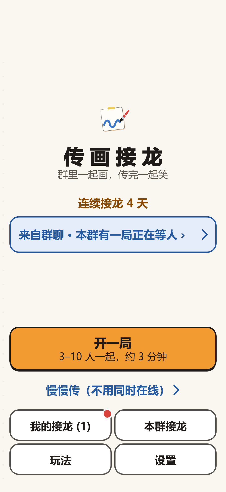

## 3. 开一局 (3 至 10 人同时玩)
1. **选题**: 屏幕给出 3 个题目, 点一个, 可「换一批」, 最多 5 次, 也可「自己出题」(会先审核)。30 秒内选定, 时间到会用你选中的题目。

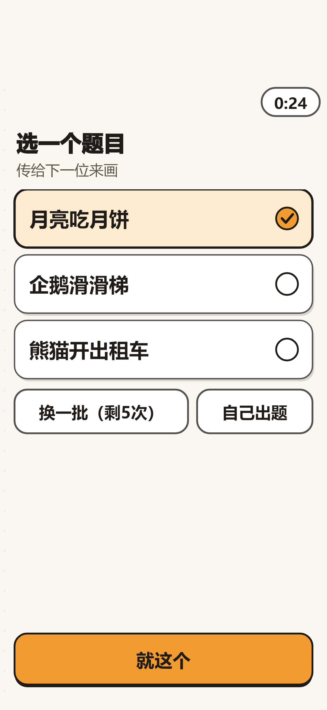

2. **等人**: 房主在等待页看到数字座位, 点「邀请群友」把卡片发到群里, 满 3 人后点「开始」。游戏不显示昵称和头像。

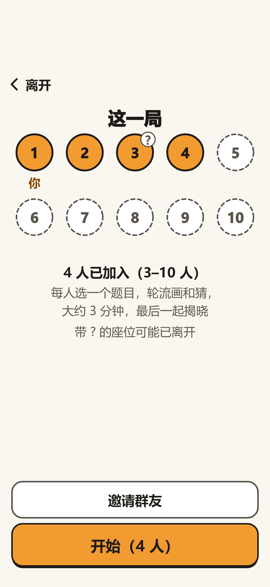

3. **画** (60 秒): 屏幕上方显示上一位传来的一句话, 其余空间是画板。选颜色和粗细, 可撤销、清空, 点「画好了」交出。时间到会自动交出, 画到一半也会保留。

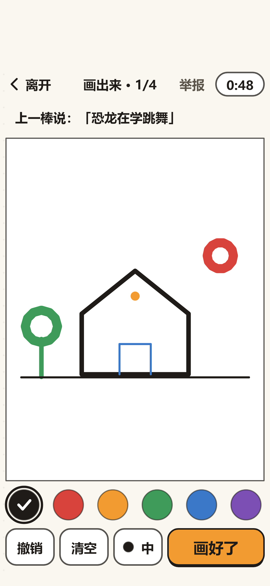

4. **猜** (45 秒): 看到上一位的画, 用一句话 (最多 16 个字) 说出画的是什么, 点交出。

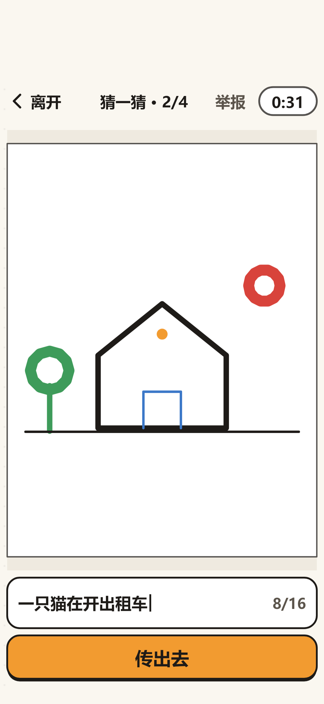

5. **等待**: 交出后等其他人, 显示已交人数。

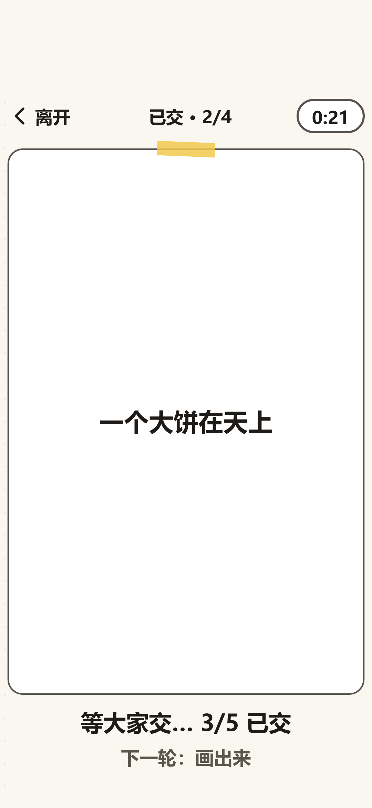

6. 每一轮拿到的是另一位玩家的接龙, 最多 4 轮; 全局最长 20 分钟。中途离开或掉线, 你之后的回合自动跳过, 这一局照常进行。

## 4. 揭晓
最后一轮结束, 所有接龙同时揭晓。先看每条接龙的最后一棒, 点进去再一步步往回看, 直到最初的题目; 可以点「笑」、回放笔迹、分享揭晓卡 (卡片不含任何玩家的画), 或点「再来一局」。

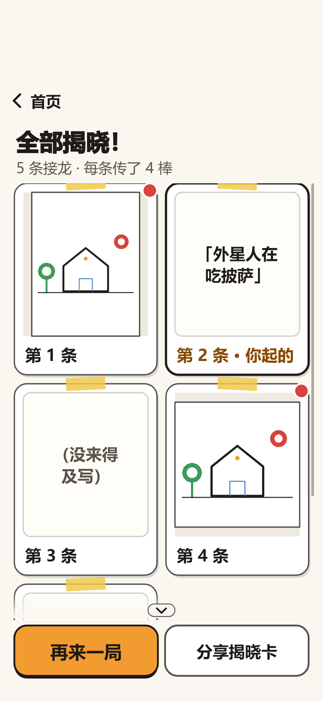
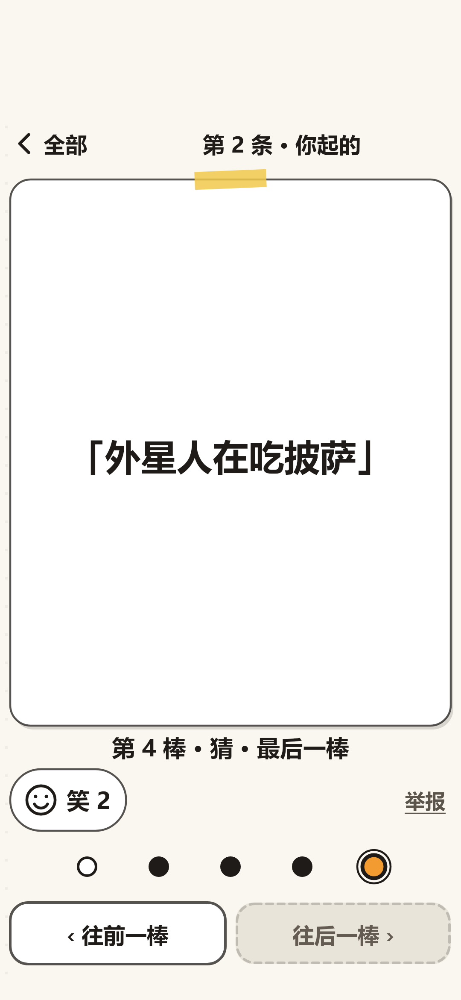

## 5. 慢慢传
不用同时在线: 一条接龙由起点和 6 棒组成, 群友在 48 小时内一棒一棒接, 两个人也能玩。点主页的「慢慢传」开始; 群里有人开了接龙, 点卡片就能接。揭晓时可选择收到一次提醒。

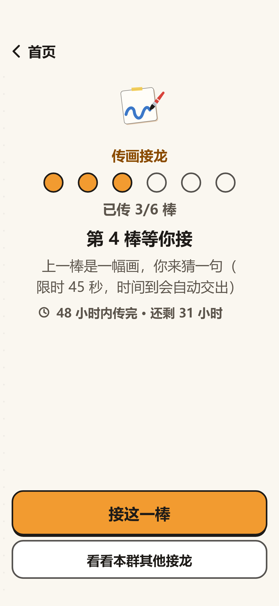

## 6. 内容安全与举报
- 你画的画和写的话, 在别人看到之前先经过内容审核; 没通过的不会展示给任何人, 你会看到提示并可修改。
- 看到不合适的内容, 点 **举报**, 选一个理由 (色情低俗、政治敏感、辱骂攻击、广告引流、其他不适)。该内容立即对所有人隐藏, 举报人不会被透露。
- 多次违规会被限制参与一段时间。

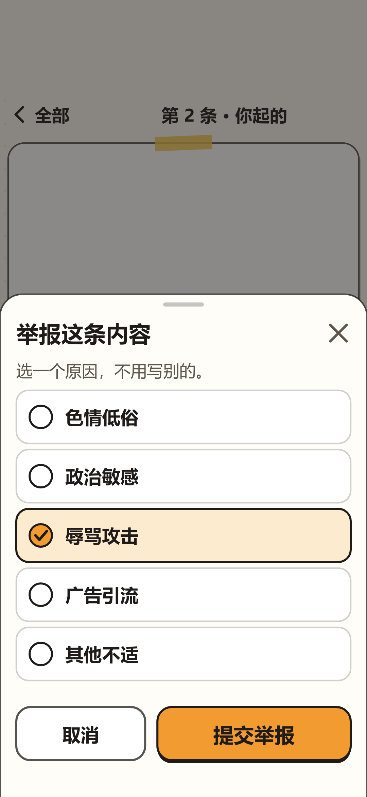
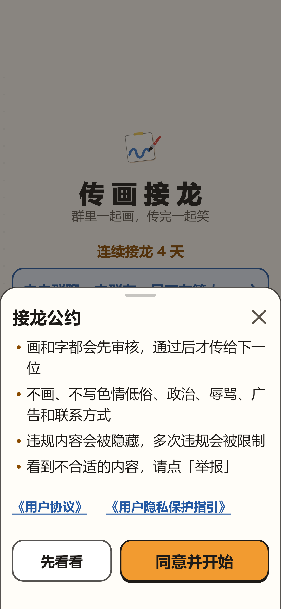

## 7. 设置与其他
- 玩法: 三行说明; 设置: 声音、大字模式、高对比度、揭晓提醒、查看《用户协议》和《用户隐私保护指引》、反馈、**删除我的全部接龙内容**。

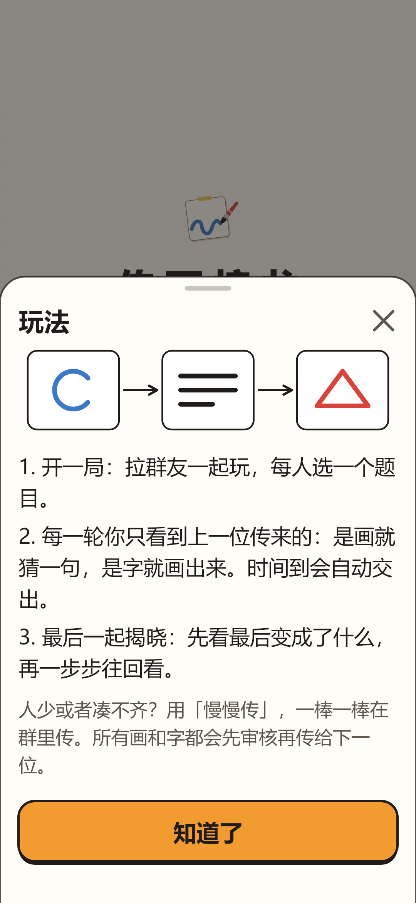
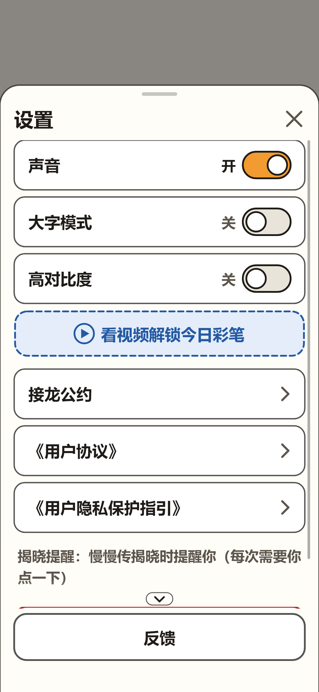

- 我的接龙: 你参与过的局和接龙; 本群接龙: 本群正在等人的局和已揭晓的接龙。
- 广告: 只有主页类页面、揭晓页离开时的插屏和你主动点开的激励视频; 选题、画、猜、等待时从不出现广告。
- 没有聊天、没有私信、没有陌生人匹配、没有公开广场、没有充值。
