# 点将台 V1.0.0 用户手册

(软著材料 2/3。图片引用 `../screenshots/` 中的 1080 x 1920 渲染图；这些图由游戏自身渲染代码用示例数据生成（期号、昵称、战绩均为示例）。提交软著前，建议在真机验收（HANDOFF 第 5 节）后用真机截图替换，文件名保持不变即可。)

## 1. 软件简介
《点将台》是在微信中直接打开的三国题材休闲策略小游戏，无需下载安装、无需注册登录。每一局有五轮：每轮翻出一个势力（魏、蜀、吴、群、晋）和一个时代（黄巾、群雄、赤壁、三分、归晋），你从该势力在该时代的历史武将中点选一员，放进主公、军师、先锋、猛将、守将五个位置之一；五轮点满后出征，游戏模拟十二场战斗，给出战绩、评级、逐场战报和评语。每天有一道“每日军令”，所有玩家拿到相同的令牌，可以和好友、群友比较。一局约一分钟。

武将以“智、信、仁、勇、严”五项品评（取自《孙子兵法》“将者，智、信、仁、勇、严也”），每项 1 到 10；武将的头像是代码绘制的印章图案，没有真人肖像。

运行环境：微信 8.0 及以上（iOS 或 Android，PC 版微信亦可），基础库 3.8.8 及以上；每日军令、榜单和挑战需要联网，自由点将可离线进行。

## 2. 进入游戏
- 在微信搜索“点将台”，或点击好友分享到聊天、群聊里的游戏卡片即可进入。
- 首次进入会自动弹出“玩法”三步说明，点“知道了”关闭；以后可点主页的“玩法”再次查看。第一局还会出现三个提示气泡（翻令、选将、放入位置），可跳过。

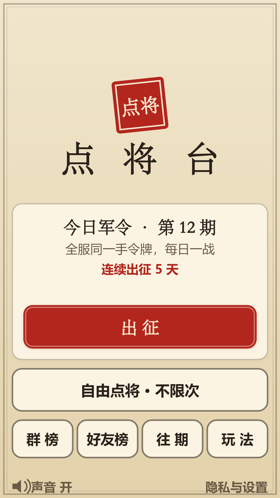

主页说明：中间是“今日军令”卡片，显示今天是第几期（每逢周日标有“识人”）、连续出征天数（连续 2 天及以上才显示），点**出征**开始今天的军令。下方是**自由点将**（不限次数）、**群榜**、**好友榜**、**往期**、**玩法**，左下角可开关声音，右下角是“隐私与设置”。若从群聊卡片进入，顶部多出“来自群聊 · 查看本群今日排行”一条。

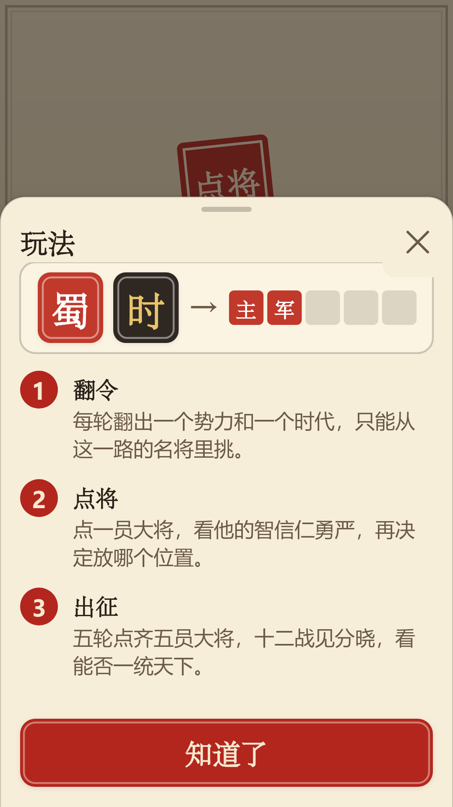

## 3. 点将：五轮翻令
1. 点**翻令**，翻出本轮的势力牌和时代牌。每日军令里，每一轮的令牌由服务器在你翻令时才发给你，所有玩家拿到的令牌完全相同。
2. 页面显示“可点之将”（最多八员）：只列出该势力在该时代出场过、且你还没点过的武将；每员显示印章头像、甲乙丙级别、五项数值。同一个人物只能点一次，已点的人物在其他令牌下显示为“已点将”。
3. 如果不满意令牌，每局可各免费换一次势力（**换势力**）和时代（**换时代**）；在自由点将中，用完后可观看一段视频再换（每局最多两次）。每日军令和挑战中没有视频换令。此令无可换时按钮显示“此令无可换”。
4. 点任意一员武将，弹出详情：印章、级别、一句话介绍、五项数值柱、数值的简要说明；下方列出每个空位置及该武将放在那里的得分和“适任 / 可用 / 错位”标注（文字加颜色）。点一个位置即放入。
5. 放入后可点**撤回**（直到下一次翻令前）。五轮点满，按钮变成**出征**。

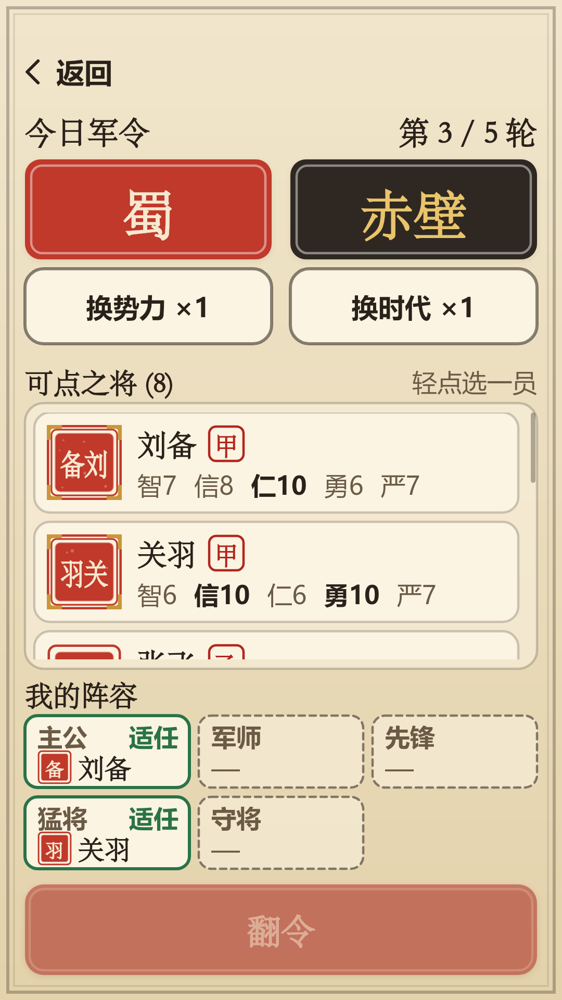

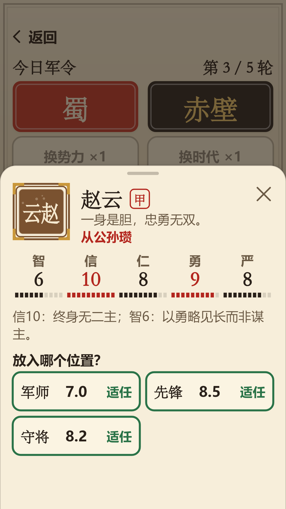

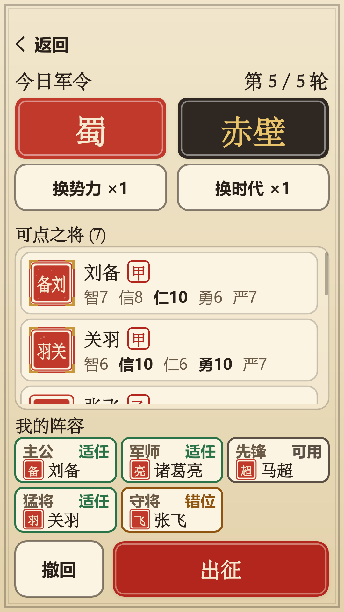

返回时：每日军令会保留进度，可稍后继续；自由点将会询问是否放弃本局。每日军令中途退出再进，会回到同一轮、同样的令牌。下一轮的令牌需要联网；断网时显示“令牌传递中断”，点**重试**即可，已选的武将不会丢失。

## 4. 出征与结果
点**出征**后，十二场战斗逐场出现，每场显示战法、胜算、天时和一句缘由；点屏幕任意处可直接看结果。结果页显示：战绩（如“十胜二负”）、评级（如“霸业将成”）、说书人评语、“今日仅 6.2% 的主公达到此战绩”、连续出征天数、十二场胜负圆点、五个位置的武将和得分（点开可看每项明细）。

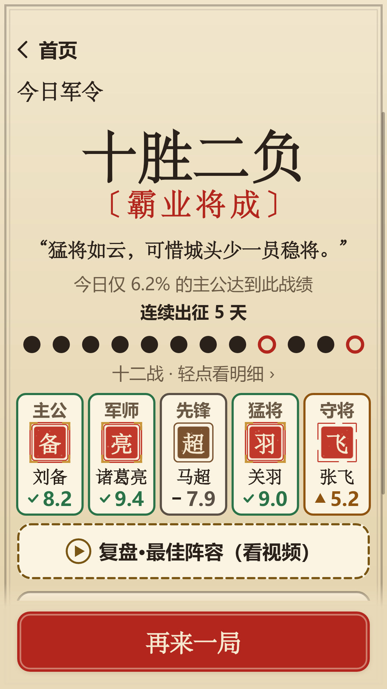

十二战全胜称“一统天下”，会盖上一统天下的印章（这是很少见的结果）。

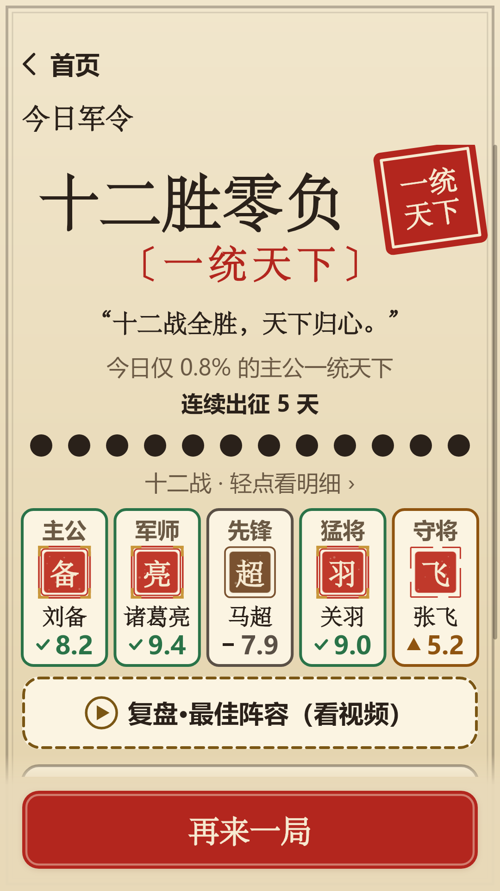

结果页按钮：
- **分享战报**：把战报图片发给好友或群（每日军令的图片不显示武将名字，避免剧透；自由点将的显示）。分享完全自愿，分享与否不会得到或失去任何东西。
- **发起挑战**：生成一封“战书”发给好友，好友用同一手令牌应战。发出后可以选择“好友应战时提醒我”（见第 8 节）。
- **保存图片**：点击后才会请求相册权限，把战报图片保存到手机；拒绝权限只会影响保存，可在提示里点“去设置”开启。
- **复盘 · 最佳阵容（看视频）**：观看一段视频后，查看用同样令牌能组成的最佳阵容和战绩差距；当日军令在你完成后才可复盘。
- **看群榜 / 好友榜**、**再来一局**（进入自由点将）。

## 5. 周日识人
每周日（北京时间）的每日军令是“识人军令”：规则相同，但**武将的五项数值、级别和适配提示在出征前都不显示**，只显示印章、姓名、字和一句介绍，凭你对三国人物的了解点将；出征后“五德揭晓”，逐个显示每个位置武将的数值、级别和得分。

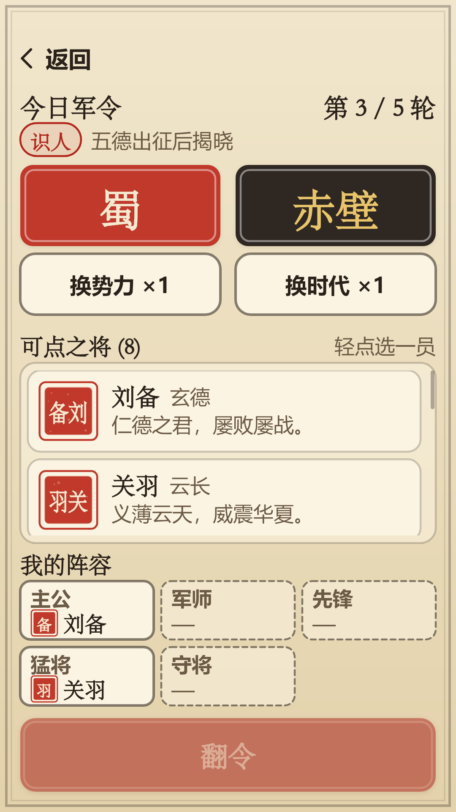

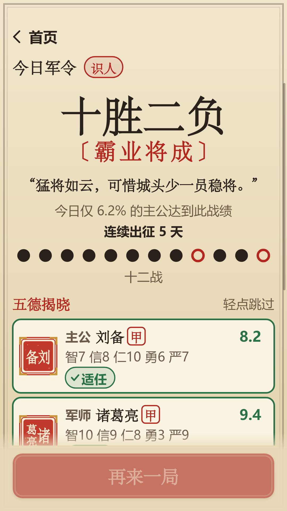

## 6. 群榜与好友榜
从群聊里的游戏卡片进入后，点“群榜”查看本群今天已出征的人：名次、昵称头像、战绩、连续出征天数和五员武将的色块；名次由服务器根据校验过的战绩计算，不以手机上写入的数据为准。你完成当日军令后才能看到别人的阵容。“好友榜”按同一规则列出同样在玩的好友。昵称和头像由微信开放数据域显示，游戏服务器不会收到。

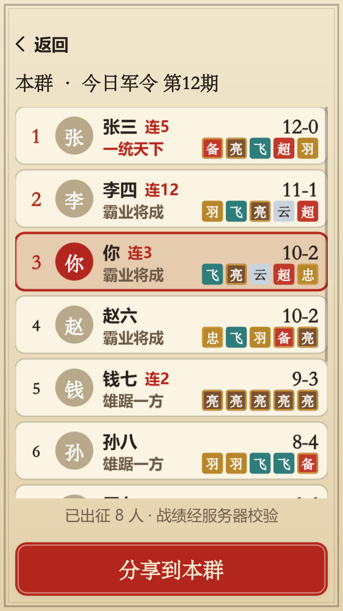

使用榜单需要在微信弹窗中同意《用户隐私保护指引》并允许使用“微信朋友关系”。如果拒绝，榜单会提示“查看排行需要同意…”或“你未开启「微信朋友关系」授权…”，并显示你自己的战绩；可在提示里点“去设置开启”。拒绝不影响其他任何玩法。

## 7. 同签挑战
好友把战书发给你，点开卡片会看到“好友向你下了一封战书”：显示对方战绩，阵容在你出征后才揭晓。如果战书用的是今天的每日军令且你还没玩今天，这一局会计作你的今日军令，计入群榜；否则是友谊赛，不计榜。战书 7 天后失效。

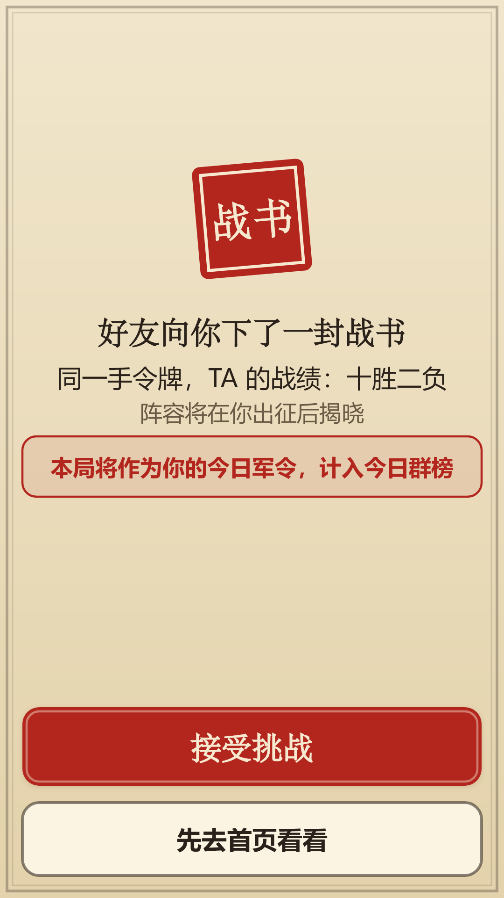

## 8. 往期、连续出征与提醒
- **往期**：列出最近 30 期军令，显示你的战绩（或“未出征”）和“识人”标记，以及最长连续出征天数；点进一期可看你的阵容和当期战绩分布，当期结束后（次日 00:30）还会公布当期最佳阵容。往期不能重玩。
- **连续出征**：连续每天完成军令的天数，没有任何奖励，也不会有“快断了”的提醒。
- **应战提醒**：发起挑战后点“好友应战时提醒我”，在微信弹窗中同意后，好友首次应战时你会收到一条服务通知（含双方战绩，不含好友姓名）；一次授权只发一条，也可以完全不开启。

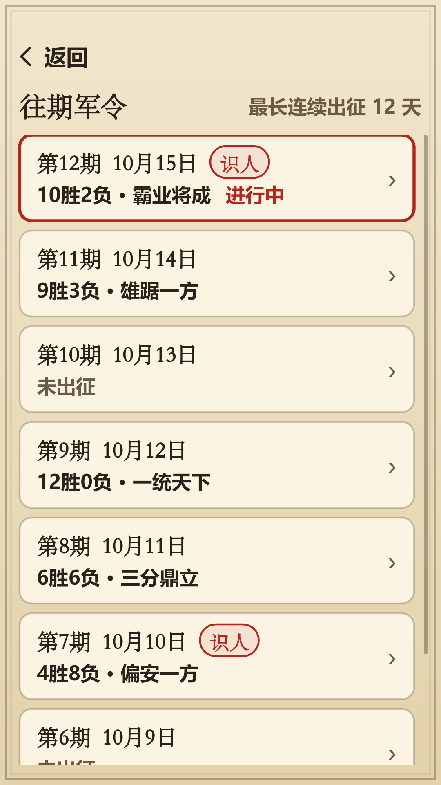

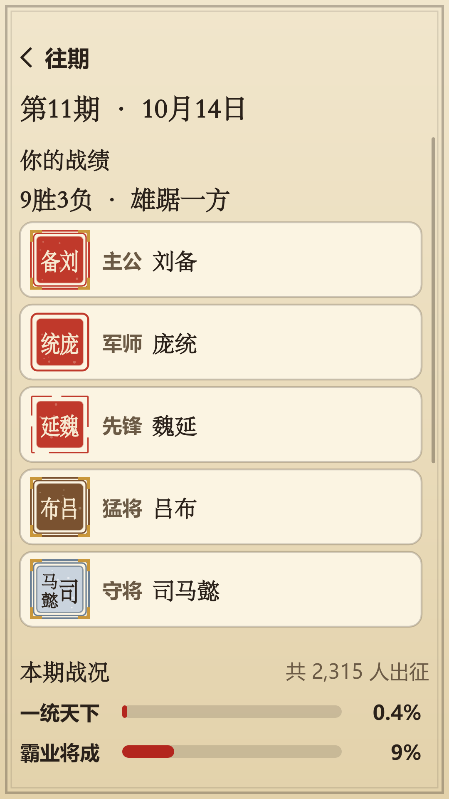

## 9. 设置与帮助
主页右下角“隐私与设置”：声音开关；**大字模式**（更大的文字和按钮）；**高对比度**（白底黑字、深色势力色）；好友排行授权状态；“用户隐私保护指引”（查看我们如何处理信息）；“联系我们 / 反馈”（由微信反馈组件提供）。

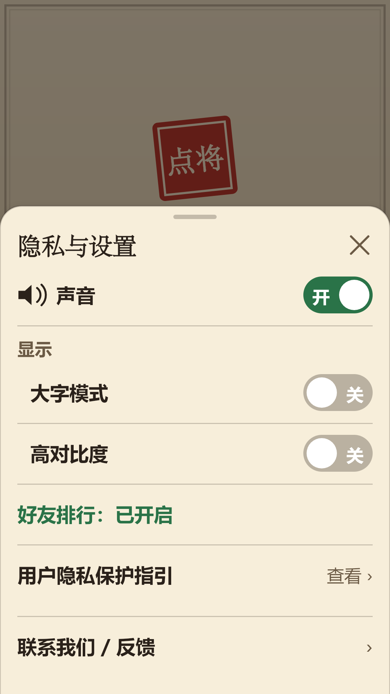

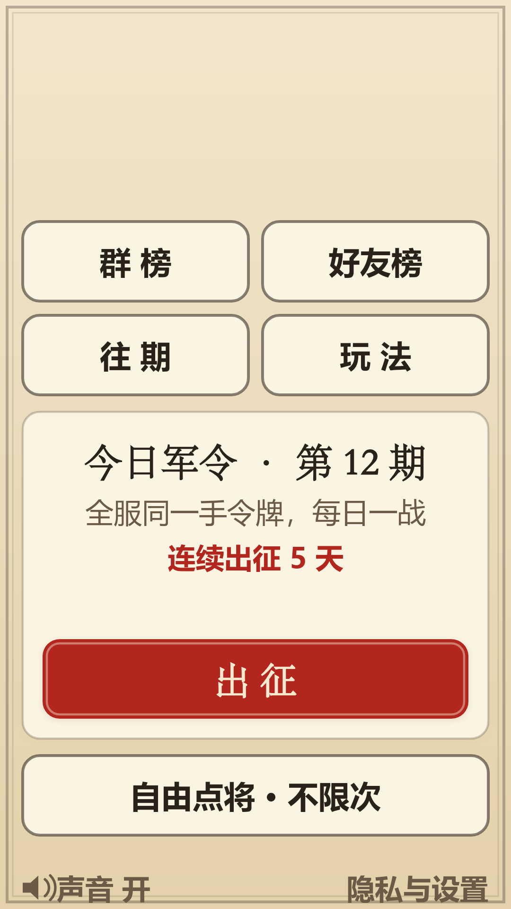

## 10. 常见问题
- **每日军令一天可以玩几次？** 每人每天一次，次日 0:00 换新令；自由点将不限次数。
- **过了零点还能提交吗？** 零点前已开始的每日军令，可在次日 00:30 前提交并计入前一天；之后只作为友谊赛。
- **为什么看不到好友昵称？** 需要在微信弹窗中同意隐私指引，并在“设置”里开启“微信朋友关系”；不同意也能正常玩。
- **提示“令牌传递中断”或“军报传递中…”？** 网络不稳，点“重试”；战绩会先保存在本机，联网后继续提交。
- **游戏里有付费吗？** 没有。没有充值、内购或虚拟货币；部分额外功能（换令、复盘）可选择观看广告，不看也能完整游玩。
- **为什么同一个武将不能点两次？** 一个人物每局只能点一次，即使他在不同势力、不同时代都出场过。
