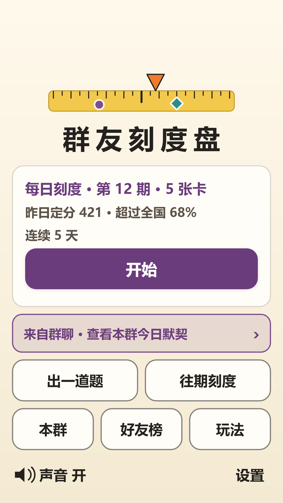
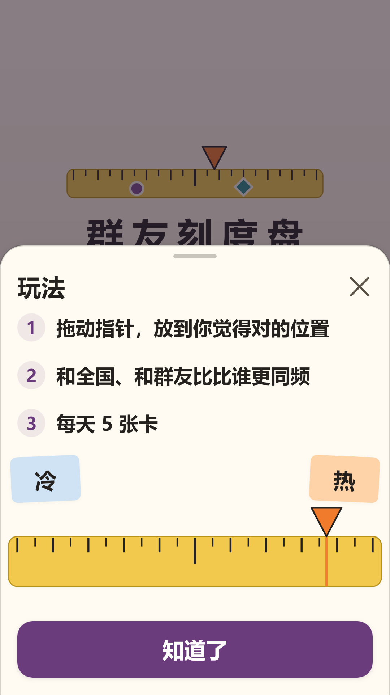
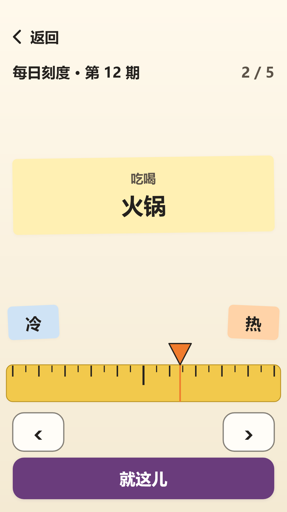
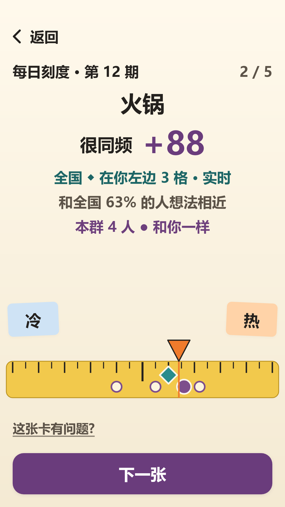
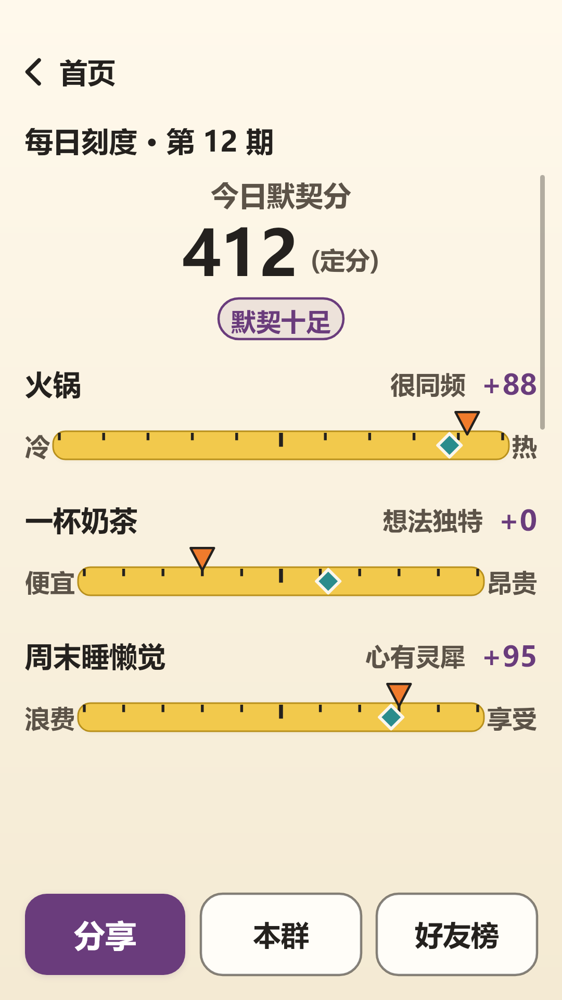
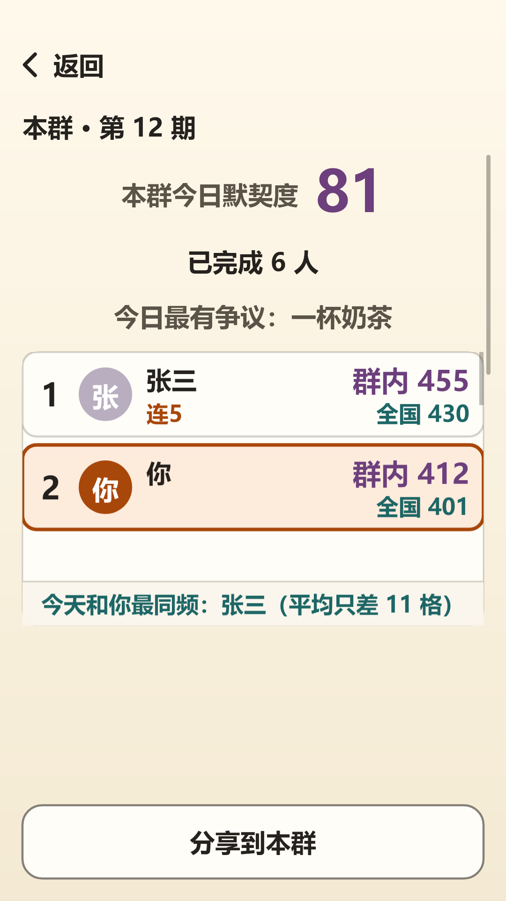
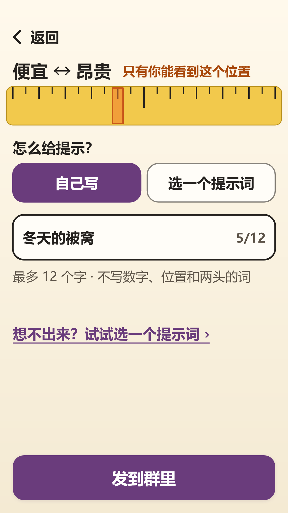
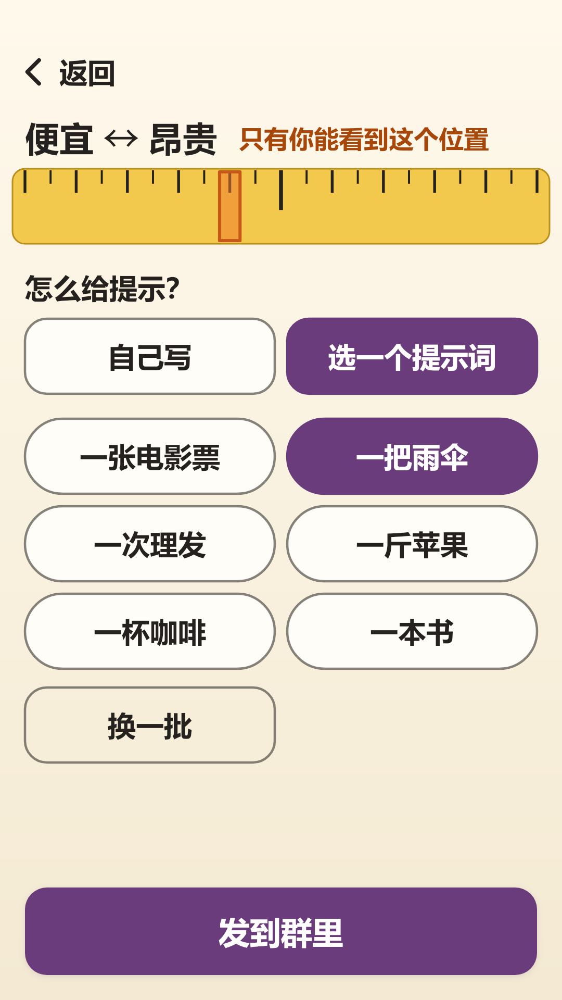
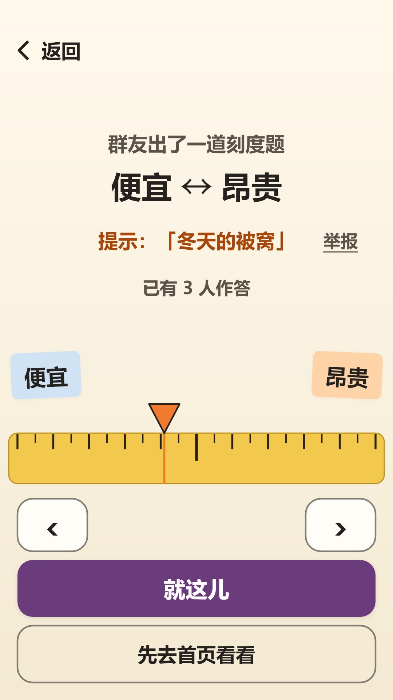
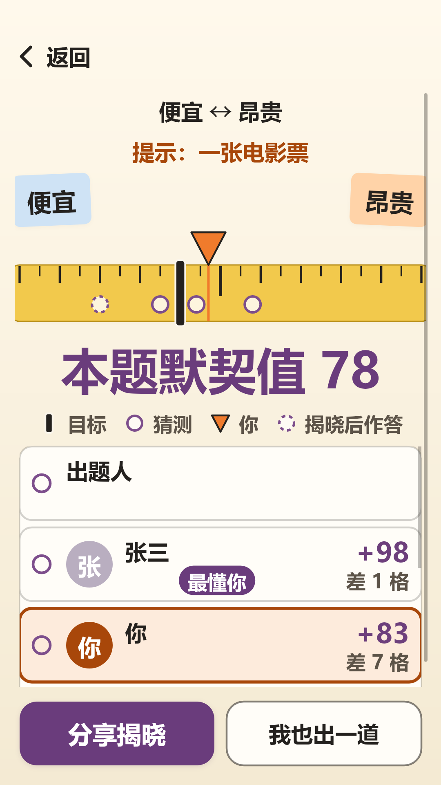

# 群友刻度盘 V1.0.0 用户手册

(软著材料 2/3。**2026-10-16 修订：第 6 节、第 8 节和第 9 节按“出题时自己写提示”更新；第 6 节的图片已于 2026-10-16 按“自己写提示”重新渲染（`09`、`07`、`11`、`06`）；发言规则和举报页面的图片尚未渲染，见 `../release-checklist.md`。**图片引用 `../screenshots/` 中的 1080 x 1920 渲染图；这些图由游戏自身渲染代码用示例数据生成。提交软著前，建议在真机验收（HANDOFF 第 5 节）后用真机截图替换，文件名保持不变即可。)

## 1. 软件简介
《群友刻度盘》是在微信中直接打开的休闲小游戏，无需下载安装、无需注册登录。每天五张卡，每张卡是一件日常事物（例如“火锅”）和一条两端含义相反的刻度（例如“冷”与“热”）。你把指针放到自己认为合适的位置，游戏立刻告诉你：全国玩家的参考位置在哪里、你和大家差几格、本群好友大致放在哪里。

运行环境：微信 8.0 及以上（iOS 或 Android，PC 版微信亦可），基础库 3.8.8 及以上；需要联网。

## 2. 进入游戏
- 在微信搜索“群友刻度盘”，或点击好友分享到聊天、群聊里的游戏卡片即可进入。
- 首次进入会自动弹出“玩法”三行说明，点“知道了”关闭；以后可点主页的“玩法”再次查看。

主页说明：中间是“每日刻度”卡片，显示今天是第几期、昨日定分和连续天数，点**开始**即可答题。下方是“出一道题”“往期刻度”“本群”“好友榜”“玩法”，左下角可开关声音，右下角是“设置”。若是从群聊卡片进入，会多出“来自群聊”一条，点开可看本群今日默契。

## 3. 每日刻度
1. 点**开始**，看到今天的第一张卡：上方便签是题目，下方是黄色的刻度尺，两端是含义相反的标签。
2. **点一下或拖动**刻度尺，橙色的▼指针会跳到你的手指处并跟随移动；松手后指针留在原处。左右的“‹ ›”按钮可以每次微调一格。界面不显示具体数字。
3. 满意后点**就这儿**，位置被记录并锁定。

4. 马上揭晓：青色◆是全国玩家的参考位置，紫色●是本群好友的中位位置，空心圈是同群好友的位置，▼是你。同时显示评语（心有灵犀 / 很同频 / 差不多 / 有点偏 / 想法独特）、本张得分，以及“和全国 63% 的人想法相近”（答题人数足够后显示）。
5. 点**下一张**继续，五张完成后点**看结果**。

6. 如果觉得某张卡不合适，点左下角“这张卡有问题？”，从“不合适 / 有歧义 / 有错字”中选一项即可，只需点选。

## 4. 今日结果
五张完成后显示**今日默契分**（满分 500）及档位（灵魂同频 / 默契十足 / 大体同频 / 各有想法 / 独树一帜），五张卡的小刻度尺回顾，以及“今日最有争议”的一张。次日 00:30 分数“定分”，并显示你超过了全国多少比例的玩家。

按钮：**分享**把今日成绩卡发给好友或群（卡片只显示题目和评语，不泄露答案位置）；**本群**、**好友榜**查看排名；“加一题”“全国分布”可观看一段广告后使用；“出一道题”“往期刻度”进入对应玩法。分享是自愿的，分享与否不会获得或失去任何东西。

## 5. 本群与好友榜
从群聊里的游戏卡片进入后，点“本群”可看到：本群今日默契度、已完成人数、今日最有争议的卡、群内排名（显示好友昵称头像，需要你在微信弹窗中同意“微信朋友关系”）、“今天和你最同频”的人，以及近 7 天走势和本群的出题记录。若你不同意授权，榜单会以“群友 A、群友 B”匿名显示，不影响游戏。好友榜按今日默契分排列同样在玩的好友。

## 6. 出一道题
1. 点“出一道题”，从三条刻度中选一条（可免费换一组）。系统随机在刻度上设定一个只有你能看到的隐藏位置（橙色色块）。
2. 给出提示，有两个页签：
   - **自己写**（默认）：点输入框，写一条不超过 12 个汉字的短提示（例如“冬天的被窝”）。只能写中文，不能写数字、位置词（如“左边”“中间”“偏贵”）和刻度两头的词，输入框下方始终显示这条规则。第一次点输入框时会先出现**发言规则**，点“同意并写提示”后才能输入；点“先用提示词”则转到另一个页签。
   - **选一个提示词**：想不出来时，点“想不出来？试试选一个提示词”，从六个现成选项里选一个，还可以免费换一批。
3. 点**发到群里**。自己写的提示会先显示“检查中…”：先经过游戏的规则检查，再由微信内容安全服务审核，通过后才会发出；没通过会提示换个说法，检查暂时出不来结果时，会让你重试或改用提示词，提示不会被展示给任何人。分享卡片上不会出现你写的提示，只写“提示在题目里，点开看看”。发出后，群友打开卡片后各自放置指针。你可以在至少两人作答后点**揭晓**，也会在第 8 人作答或 24 小时后自动揭晓。
4. 群友看到的是你的提示（出题人对大家是匿名的）。如果觉得某条提示不合适，可以点**举报**，选一个理由（色情低俗 / 政治敏感 / 辱骂攻击 / 广告引流 / 其他不适），被举报的提示会立刻对所有人隐藏，题目仍可继续猜。不能举报自己的提示。
5. 多次写出违规提示会被暂时限制自己写提示（只影响写提示，仍可玩每日刻度、往期刻度、猜题，也可选提示词出题）。

6. 揭晓页显示隐藏位置、每个人的位置、**本题默契值**和“最懂你”的人。

## 7. 往期刻度
主页点“往期刻度”，按日期倒序列出已结束的每一期；可回看自己玩过的、练习没玩过的。往期练习不计入排名，也可以连续练习多期。

## 8. 设置与帮助
主页右下角“设置”：声音开关；**大字模式**（更大的文字和按钮）；**高对比度**（白底黑字）；好友排行授权状态与“去设置”；**发言规则**（随时查看出题提示的规则）；“用户隐私保护指引”（查看我们如何处理信息）；《用户协议》；“联系我们 / 反馈”（由微信反馈组件提供，也可以用来要求删除你写过的提示）。

## 9. 常见问题
- **看不到好友昵称？** 需要在微信弹窗中同意隐私指引，并在“设置”里开启“微信朋友关系”；不同意也能正常玩。
- **提示“网络不稳，答案还没送达”？** 点“重试”；答案保存在本机，联网后可继续。
- **一天可以玩几次？** 每日刻度每天一套五张；往期刻度不限次数。
- **分数什么时候最终确定？** 次日 00:30。在此之前分数会随更多玩家作答而实时变化，标注“实时”。
- **我写的提示为什么发不出去？** 提示必须是 1 到 12 个汉字，不能含数字、位置词、刻度两头的词和联系方式；通过规则检查后还要经过微信内容安全审核。看到“提示暂时没法检查”时点“重试”，或改用提示词。
- **我写的提示保存多久？** 随这道题保存，最长 180 天，到期自动删除。
- **游戏里有付费吗？** 没有。游戏没有充值或购买；部分额外功能需要观看广告。
